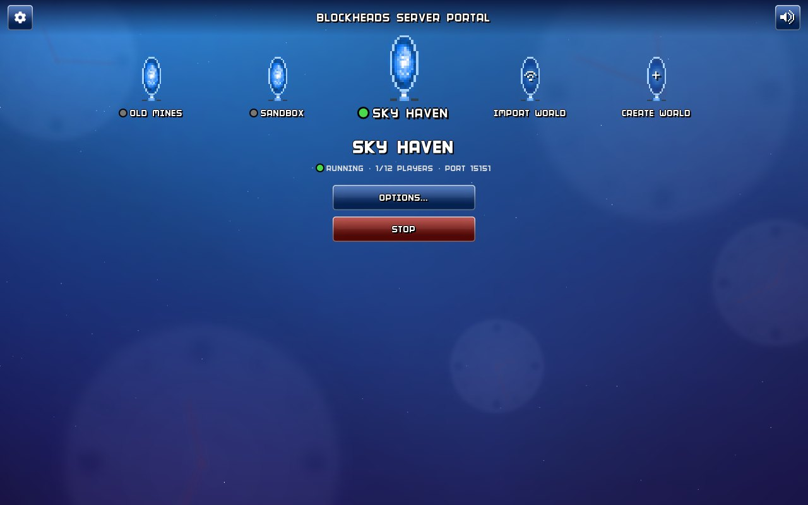
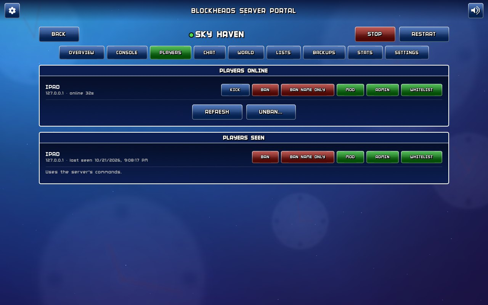
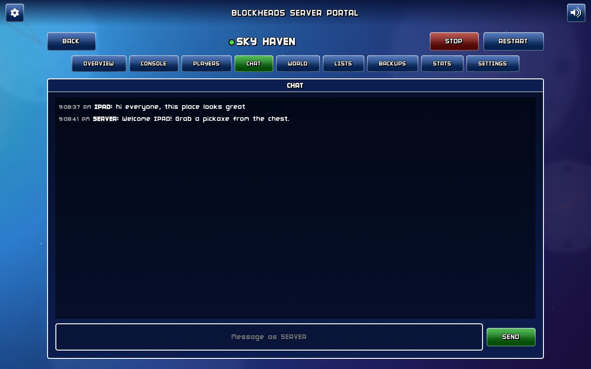
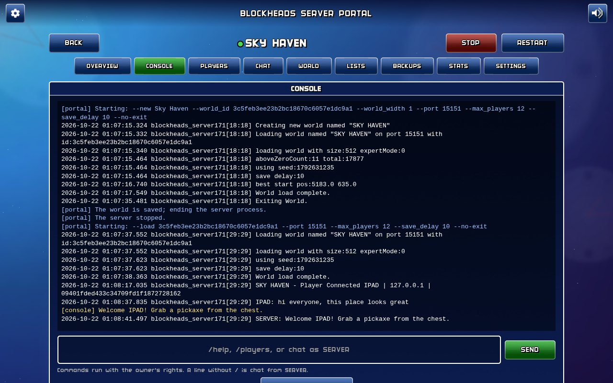
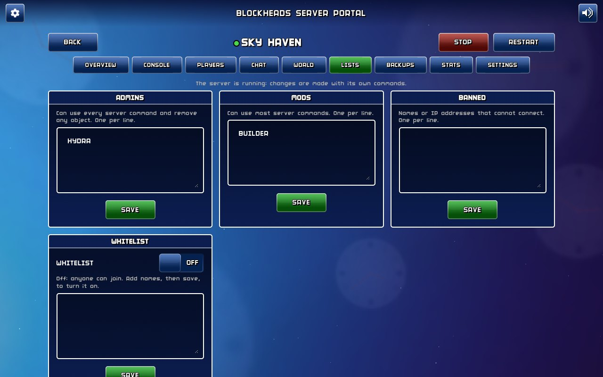
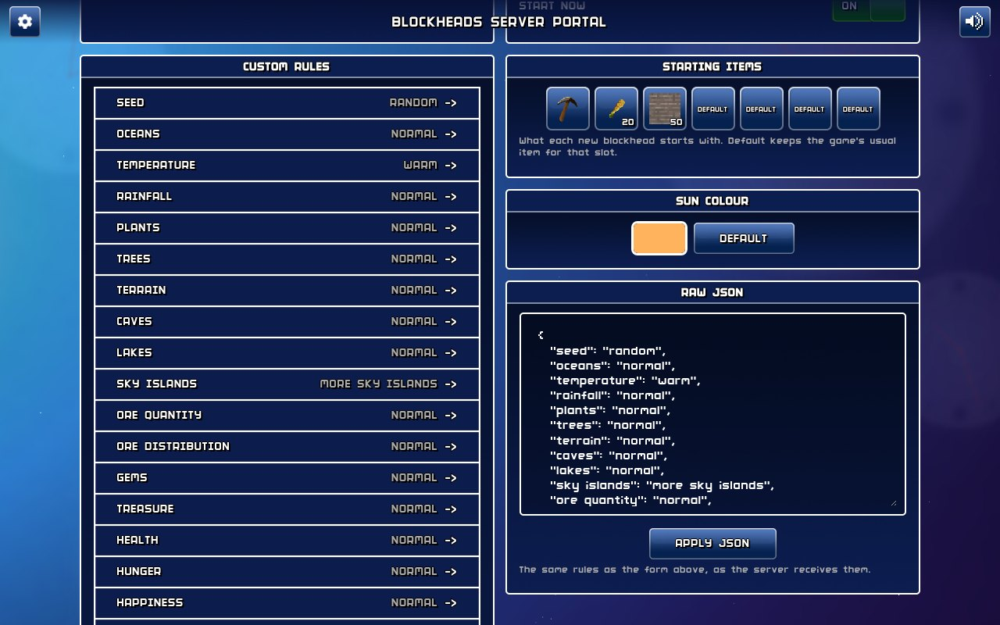
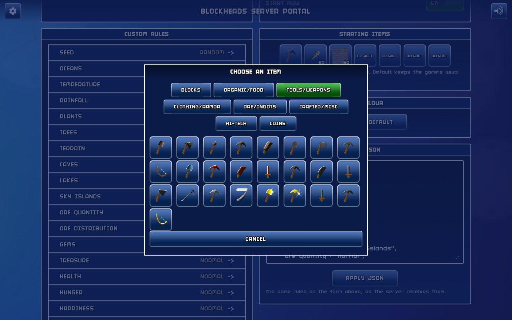
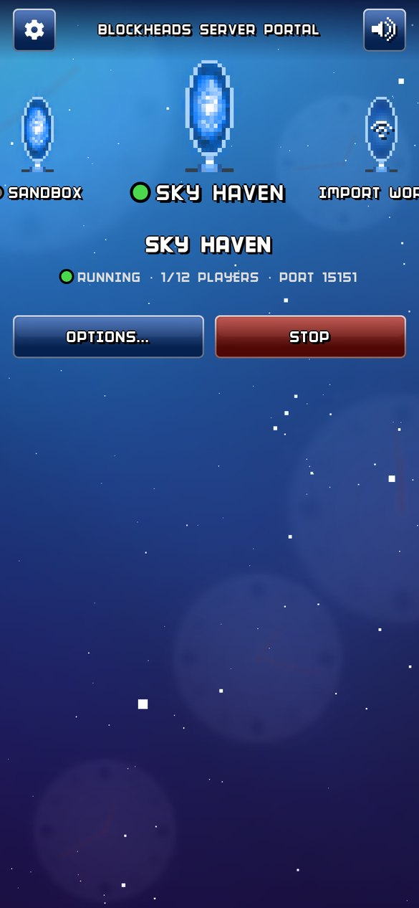
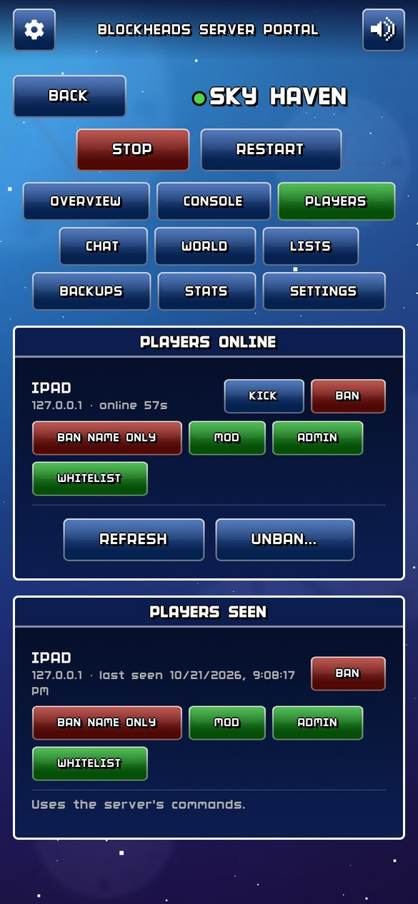

# Blockheads Server Portal

A self-hosted web portal for running any number of **The Blockheads 1.7.1** dedicated servers, dressed in the
game's own art: its menu background and clocks, portals for worlds, its buttons, dialogs, font and sounds.



- Create, start, stop, restart and delete servers; each runs one world on its own UDP port.
- Every server option: port, max players, save interval, world size, expert mode, every custom rule (with the
  game's starting-item picker and sun colour), conversion to custom rules.
- Live console, players online (kick, ban, mod, admin, whitelist), players seen, chat as SERVER, diagnostics.
- Admin / mod / ban / whitelist lists, welcome message, password and PvP.
- Worlds: export to .zip, import, clone, rename, delete to a 7-day trash.
- Backups: scheduled per server, automatic before risky changes, one-click restore.
- Mods (`.so` files loaded into the server), stats graphs, in-portal notifications.

## Screenshots

| | |
|---|---|
|  |  |
| **Players**: who is online and who has joined, with the moderation actions | **Chat**: read the server's chat and talk as SERVER |
|  |  |
| **Console**: the live log, and any server command | **Lists**: admins, mods, bans, and a whitelist switch |
|  |  |
| **Create World**: every custom rule, starting items, sun colour, raw JSON | **Starting items**: the game's own picker and item icons |

On a phone:

<p>
  
  
</p>

## Requirements

- Linux host, x86-64 (the 1.7.1 server is x86-64 only; the portal uses host networking, which Docker Desktop on
  macOS / Windows does not handle well).
- Docker with Compose.
- Your own copy of The Blockheads for Android (the APK) for the theme. The portal ships no game files: the
  images, fonts, sounds and the menu's star field are extracted from your APK at setup. Without the APK it
  works with a plain look.

## Running it

```sh
git clone https://github.com/PreDawnHydra/Blockheads_Server_Manager.git && cd Blockheads_Server_Manager
docker compose up -d --build
```

Open `http://<host>:8080`. The first visit asks for an admin password (or set `PORTAL_PASSWORD` in
`docker-compose.yml`), then for the APK.

Game servers listen on UDP ports from 15151 up (the next free one, or one you choose). Open those in your
firewall or forward them on your router for players outside your network. Players join with **Join World →
Advanced... → Online IP/Port...** in the game.

### Settings (environment)

| Variable | Default | |
|---|---|---|
| `PORTAL_PORT` | `8080` | Web UI port |
| `PORTAL_PASSWORD` | — | Admin password; when unset, the first-run page sets one |
| `PORTAL_DATA` | `/data` | Where everything is kept |

### Data

Everything lives in the `/data` volume (`./data` in the compose file):

```
data/worlds/     the servers' save folders (one per world id)
data/backups/    backups (or a separate /backups mount if you add one)
data/trash/      deleted worlds, kept 7 days
data/mods/       uploaded mods
data/logs/       server logs (rotated at 5 MB, 5 kept)
data/assets/     the theme, extracted from your APK
data/portal.db   settings, server settings, sessions, stats
```

### HTTPS and remote access

The portal speaks plain HTTP. To reach it from outside your network, put it behind your own reverse proxy
(Caddy, Nginx Proxy Manager, Traefik) with HTTPS. Browser notifications only work over HTTPS (or on
`localhost`).

### Stopping and updating

`docker compose down` (or `stop`) sends every server `/stop` so it saves before exiting; the compose file allows
60 seconds for that. To update: `git pull && docker compose up -d --build`.

## Notes

- **Sounds**: buttons play the game's `clickDown` / `click`. The game has no start or error sound in its menus;
  the portal uses its `portal` sound for starting a server and `badPath` for errors.
- **Mods** are native code running inside the game server with full access to the container. Only use mods you
  trust; they are off on every server until you enable them.
- **Server quirks the portal handles**: the server ignores stop signals (so the portal always stops it with
  `/stop`), quits when the last player leaves unless started with `--no-exit` (always passed), and its real
  defaults differ from its help text (so every option is passed explicitly).
- The game server is Majic Jungle's free 1.7.1 Linux server. The `Dockerfile` downloads it from its archive.org
  copy (`BHSv171`), checks its checksum, points it at Ubuntu 22.04's libraries (it is a GNUstep program; 22.04
  packages the GNUstep base 1.28 it runs on) and checks the result is the exact binary the portal is tested
  with. The build needs only Ubuntu and archive.org.

## Development

```sh
python3 -m venv .venv && .venv/bin/pip install -r requirements.txt pytest playwright
.venv/bin/python -m pytest tests/test_parsing.py
.venv/bin/python tests/ui_walkthrough.py http://127.0.0.1:8080/ /tmp/shots --apk path/to/blockheads.apk
```

Design and decisions: [docs/SPEC.md](docs/SPEC.md); progress: [docs/PLAN.md](docs/PLAN.md).
